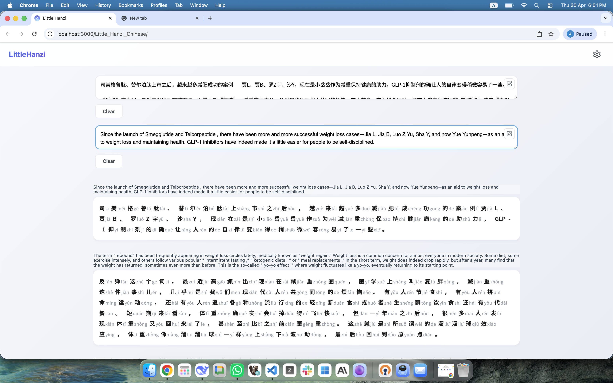

# Little Hanzi Chinese

Little Hanzi is a reading-first app for learning Chinese. Instead of drilling flashcards, you paste real Chinese text (with an optional English translation) and read it with pinyin beside every character, translations woven into each paragraph, and tools to bookmark, like, save, and share what you read.

I built it for myself because I couldn't find an open-source reading tool that worked the way I wanted. It's public so anyone with the same problem can use it too.

**Live app:** [Little Hanzi Chinese](https://amaan-samar.github.io/Little_Hanzi_Chinese/)



## What it does

Paste Chinese text and its English translation, then read them together with pinyin pronunciation guides. Articles are saved on your device, organised into history tabs, and can be shared as a QR code, a link, or a JSON file. The whole app installs as a PWA and works offline.

Everything is stored locally in your browser. There are no accounts, no servers, and no tracking.

## Features

### Reading and display

- **Paragraph-by-paragraph comparison** — Chinese and English are aligned block by block, so you always see the translation for the paragraph you're reading.
- **Pinyin for every character** — powered by `pinyin-pro`, shown beside each Chinese character.
- **Interleaved mode** — alternate Chinese and English line by line inside a paragraph, or keep the languages in separate blocks.
- **Flexible display order** — English → Chinese or Chinese → English.
- **Independent visibility toggles** — show or hide pinyin, Chinese, and English separately.
- **Separate text sizes** — adjust Chinese, pinyin, and English sizes independently, with a live preview in Settings.
- **Seven Chinese fonts** — Noto Sans SC, Noto Serif SC, Inter, Roboto, Poppins, ZCOOL KuaiLe, and Ma Shan Zheng.
- **Responsive layout** — designed for phones, tablets, and desktop, with a bottom navigation bar on every screen.

### Reading tools

- **Multi-article workspace tabs** — open several articles side by side and switch between them without losing your place.
- **Bookmarks** — double-click (or double-tap) a paragraph, or use its menu, to mark where you stopped.
- **Resume banner** — on launch, the app offers to continue the article you left mid-read at your bookmarked paragraph.
- **Likes** — heart a paragraph you enjoyed; Liked articles are ranked by how many paragraphs you liked.
- **Paragraph actions** — bookmark, like, edit the paragraph in the source editor, or copy it from the `⋮` menu.
- **Edit in a popup** — open the Chinese or English text in a full editor modal for longer edits.
- **Paste and clear** — one-tap paste from the clipboard and clear either field.
- **Drag and drop** — drop a Little Hanzi `.json` bundle onto the app to import it.
- **Loading screen** — a branded spinner shows while restoring your last article or opening one from History, so the app never sits on a blank screen.
- **Toasts** — clear confirmation for saves, shares, imports, deletes, and errors.

### History and organisation

- **Instant autosave** — every edit is saved immediately, and the active tab is flushed when you switch tabs, hide the page, or close it.
- **History tabs** — Reading (bookmarked, unfinished), Unread, Liked, Shared, All, and Archived. Empty categories are hidden automatically.
- **Read and unread states** — imported articles start unread, with an unread dot on the card.
- **Archive** — move finished or old articles out of the main list without deleting them.
- **Delete one or all** — with confirmation dialogs.
- **300-article capacity** — oldest read, unliked, unarchived articles are pruned automatically if browser storage fills up.
- **Article cards** — title, date, Chinese preview, unread state, shared-by attribution, and quick share/archive/delete actions.

### Sharing

- **QR code sharing** — one QR carries the full article (Chinese + English), with a downloadable PNG.
- **Share link** — a compressed URL payload that opens the article directly in the app.
- **Native sharing** — use the Web Share API to send the link or a JSON file to another app.
- **JSON file export** — send the article file through any messaging app.
- **Incoming shares** — open a shared link or scan a QR code to import the article, with duplicate-merge handling.
- **Shared-by attribution** — your profile name is attached to what you share.
- **Bilingual payloads** — one code carries both languages; if an article is too large to encode, the app tells you and offers the JSON file instead.

### QR scanner

- **Camera scanning** — point your camera at a Little Hanzi QR code.
- **Image import** — choose a screenshot or image of a QR code instead.
- **Smart parsing** — accepts full app URLs, raw `share=` payloads, and JSON bundles, so QR codes can carry articles or library backups.

### Backup and data

- **Automatic database backup** — connect a JSON file on disk with the File System Access API and the app keeps it updated in the background. The file survives clearing browser data.
- **Reconnect and disconnect** — re-grant permission or stop automatic backups at any time.
- **Download backup** — export your full library and profile as a dated JSON file.
- **Import backup** — restore or merge a backup file into the current library.
- **Export share library** — create a JSON bundle of your articles for sharing outside the app.
- **Profile included in backups** — restoring a backup on another device brings your name, details, and photo with it.
- **Quota-aware storage** — graceful pruning instead of a silent failure when localStorage is full.

### Profile

- **Personal details** — name, email, phone, occupation, country, city, address, and a short bio.
- **Profile photo** — upload an image; it is automatically resized and centre-cropped to keep backups small.
- **Full photo viewer** — click the avatar to view the photo full-screen, then change or remove it.
- **Bottom-nav avatar** — your photo replaces the generic Profile icon in the navigation bar.
- **Auto-saved instantly** — profile edits are saved immediately, so closing the tab never loses changes.
- **Profile sections** — Profile, Location, About, Fonts, Settings, and Data, all in one place.
- **Share identity** — your profile name is used as the default “shared by” name.

### App and PWA

- **Installable** — add to your home screen on Android, iOS, and desktop.
- **Offline support** — a service worker precaches the app shell so it opens without a network connection.
- **Auto-updates** — the service worker updates in the background on new deployments.
- **Home-only header** — the Home tab has article actions (new tab, share, scan, info); History and Profile stay clean.
- **Bottom navigation** — Home, History, and Profile.
- **Info panel** — app explanation, reading tips, learning resources, and links to other projects.

## Demo content

The `/data` folder contains sample articles:

- `cn.txt` — Chinese text samples
- `en.txt` — English translations

Paste them into the app to see how it works.

## Setup

```bash
# Clone the repo
git clone https://github.com/Amaan-Samar/Little_Hanzi_Chinese.git

# Install dependencies
npm install

# Run locally
npm run dev

# Build for production
npm run build

# Preview the production build
npm run preview
```

The app is built for the GitHub Pages subpath `/Little_Hanzi_Chinese/`. Pushing to `main` triggers the workflow in `.github/workflows/deploy.yml`, which builds `dist` and deploys it to the `gh-pages` branch.

## Tech stack

- **Vue 3** — UI and reactivity
- **Vite** — dev server and production build
- **vite-plugin-pwa** — manifest, service worker, offline caching
- **pinyin-pro** — Chinese romanization
- **lucide-vue-next** — icons
- **jsQR** — QR scanning
- **qrcode** — QR generation
- **lz-string** — compressed share links

## Browser notes

- Automatic file backups need the File System Access API and currently work best in Chromium-based desktop browsers. Everywhere else, JSON download and import still work.
- Camera scanning needs HTTPS or `localhost` and camera permission. Image-based scanning works without a camera.
- Data lives in `localStorage` and IndexedDB on your device. Clearing site data removes your library unless you have a backup file connected.

## License

MIT
